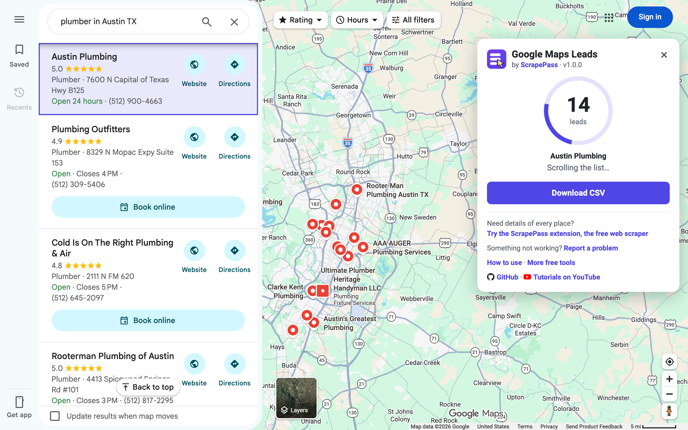

  

# 📍 Google Maps Scraper One Click

**Free Google Maps scraper in one bookmark.** Export the businesses from any Google Maps search to a CSV file for
Excel or Google Sheets: name, category, rating, reviews, phone, website, address, opening status, coordinates and
map link. No sign-up, no install, no API key, and nothing is sent anywhere.

Ideal for lead generation, market research and local business analysis.

### [➕ Add the bookmark](#install)

[Tutorials on YouTube](https://www.youtube.com/@scrapepass) · [More free tools](https://scrapepass.com/free-tools) ·
[scrapepass.com](https://scrapepass.com/?utm_source=github&utm_medium=readme&utm_campaign=google-maps-leads)

> **Need a more powerful tool?** [Try ScrapePass, the free web scraper →](https://scrapepass.com/?utm_source=github&utm_medium=readme&utm_campaign=google-maps-leads)

---

## How it works

1. Search Google Maps for a kind of business in a place, for example **dentist in Chicago**.
2. Click the **📍 ScrapePass - Google Maps Leads** bookmark. A small panel opens and asks **Ready?**
3. Press **Go**. The list scrolls by itself until Google Maps reaches the end of the list. A purple highlight moves
   down the places one by one, and the panel counts the leads as it goes.
4. Press **Download CSV**. The file is named after your search, for example
   `ScrapePass Google Maps Leads - dentist in Chicago.csv`.

## Install

You need a desktop browser with a bookmarks bar, such as Chrome, Edge or Brave. No bookmarks bar? Press
`Ctrl` + `Shift` + `B` (on a Mac, `⌘` + `Shift` + `B`).

### 1. From the web

Open **[➕ Add the bookmark](https://scrapepass.com/tools/google-maps-scraper#add-bookmark)** and drag the
**📍 ScrapePass - Google Maps Leads** button to your bookmarks bar. That's all. GitHub does not allow bookmark
buttons in READMEs, so the button lives on our website.

### 2. Manually, from the source on GitHub

The whole tool is one file, [`bookmarklet.js`](bookmarklet.js). Turn it into a bookmark yourself:

1. Open [`bookmarklet.js`](bookmarklet.js) and press **Copy raw file** (or open **Raw**, select all and copy).
2. Right-click your bookmarks bar and choose **Add page…** (Edge calls it the favorites bar).
3. Name it `📍 ScrapePass - Google Maps Leads`.
4. In the URL field, type `javascript:` and paste the code right after it, with no space in between.
5. Save.

The URL field joins the code into one line. That's expected: the code is written to run that way.

Either way, the bookmark only runs when you click it, and only on the Google Maps page you have open.

## What you get

One row per place:

| Column | What it holds | Example |
| --- | --- | --- |
| `name` | The business name | Lone Star Plumbing Co. |
| `category` | Main category on Google Maps | Plumber |
| `rating` | Average star rating | 4.8 |
| `reviews` | Number of reviews | 1232 |
| `phone` | Phone number, when the list shows one | +1 512-555-0142 |
| `website` | The business website, when the list shows one | https://lonestarplumbing.example |
| `address` | Street address as shown in the list | 1500 Congress Ave |
| `hours` | Opening status when you ran it | Open · Closes 6 PM |
| `latitude`, `longitude` | Where the place is on the map | 30.2747, -97.7404 |
| `maps_url` | Link to the place on Google Maps | https://www.google.com/maps/place/… |

The examples are made up. The CSV is UTF-8 with a byte order mark, so accented letters show correctly in Excel.

## Privacy

Everything happens in your browser. The bookmark reads the list on the page you have open and builds the CSV there.
Nothing is sent to ScrapePass or anyone else, and the panel loads no images, fonts or scripts. The full source code
is in [`bookmarklet.js`](bookmarklet.js).

## FAQ

**Is it really free?**
Yes. No account, no limit on how often you use it, and nothing to install.

**How many places can I get from one search?**
As many as Google Maps shows in the list, usually up to about 120 per search. For more, search smaller areas (one
neighborhood or ZIP code at a time), or move the map, use "Search this area" and run the bookmark again. If Google
Maps says you are seeing a limited view, sign in to Google to load the full list.

**Why are some phones and websites missing?**
The bookmark reads the results list. For some kinds of business (dentists, for example) Google Maps shows a
"Book online" button there instead of a phone and website. To get every place's phone, website and full address,
use the [ScrapePass Google Maps template](https://scrapepass.com/templates/google-maps), which opens each place.

**Does it get emails?**
No. Google Maps does not show emails. The CSV has each business's website, so you can find contact details there.

**Does it work in other languages and countries?**
Yes. It works on Google Maps in any language and on any Google domain (google.com, google.co.uk, google.de and so
on). Categories and opening status come in the language Google Maps shows.

**Does it work on phones?**
No. Phones and tablets make bookmarks like this hard to run, so use a computer.

**It stopped working. What now?**
Google Maps changes its page from time to time. Press **Report a problem** in the panel, or
[contact us](https://scrapepass.com/contact), with the search you ran and a screenshot of the panel. Once it is
fixed, [add the bookmark](#install) again with the new `bookmarklet.js`: a bookmark keeps the code it was created
with.

## Version

Current version: **1.0.0** (the `VERSION` line at the top of [`bookmarklet.js`](bookmarklet.js)). The panel shows
the version of your bookmark next to "by ScrapePass". If it is older, [add the bookmark](#install) again.

## Need a more powerful tool?

**[Try ScrapePass](https://scrapepass.com/?utm_source=github&utm_medium=readme&utm_campaign=google-maps-leads)**,
the free web scraper for Chrome. It turns any web page into clean data, with prebuilt templates for Google Maps,
Amazon, Indeed and many more sites, and exports to Excel, CSV or JSON.

## Responsible use

Only collect data you have the right to use, and follow Google's terms and the privacy laws where you work.

## License

[MIT](LICENSE) © 2026 ScrapePass
