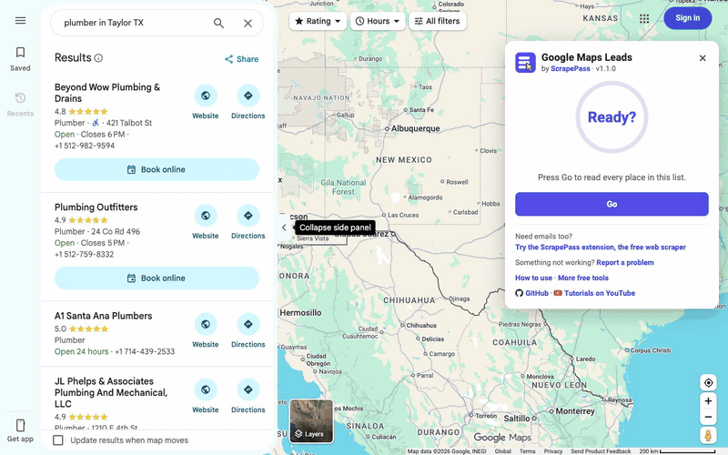

  

# 📍 Google Maps Scraper One Click

**Free Google Maps scraper in one bookmark.** Export the businesses from any Google Maps search to a CSV file for
Excel or Google Sheets: name, category, rating, reviews, phone, website, full address, opening status, coordinates
and map link. It opens each place for its details, and when the list runs out you move the map for more. No sign-up,
no install, no API key, and nothing is sent anywhere.

Ideal for lead generation, market research and local business analysis.

### [➕ Add the bookmark](#install)

[Tutorials on YouTube](https://www.youtube.com/@scrapepass) · [More free tools](https://scrapepass.com/free-tools) ·
[scrapepass.com](https://scrapepass.com/?utm_source=github&utm_medium=readme&utm_campaign=google-maps-leads)

> **Need a more powerful tool?** [Try ScrapePass, the free web scraper →](https://scrapepass.com/?utm_source=github&utm_medium=readme&utm_campaign=google-maps-leads)

---

## How it works

1. Search Google Maps for a kind of business in a place, for example **dentist in Chicago**.
2. Click the **📍 ScrapePass - Google Maps Leads** bookmark. A small panel opens and asks **Ready?**
3. Press **Go**. The bookmark clicks each place in the list, one at a time, and reads its phone, website and full
   address from the place's page. The place being read is highlighted in the list, and the panel counts the leads.
   The list scrolls by itself to load more places.
4. When the list has no more places, the panel asks you to **drag or zoom the map** to load more places (press
   "Search this area" if it shows). New places carry on the run by themselves. Press **Finish** when you have
   enough.
5. Press **Download CSV**. The file is named after your search, for example
   `ScrapePass Google Maps Leads - dentist in Chicago.csv`. It works at any time, with the places read so far.

Use a browser window at least 1200 px wide (maximize it, or zoom the page out with `Ctrl` or `⌘` and `−`). In a
narrower window, Google Maps shows a place instead of the list. Leave "Update results when map moves" unticked while
it runs: opening a place moves the map, and the list would change under it.

## Install

You need a desktop browser with a bookmarks bar, such as Chrome, Edge or Brave. No bookmarks bar? Press
`Ctrl` + `Shift` + `B` (on a Mac, `⌘` + `Shift` + `B`).

### 1. From the web

Open **[➕ Add the bookmark](https://scrapepass.com/tools/google-maps-scraper#add-bookmark)** and drag the
**📍 ScrapePass - Google Maps Leads** button to your bookmarks bar. That's all. GitHub does not allow bookmark
buttons in READMEs, so the button lives on our website.

### 2. Manually, from the source on GitHub

The whole tool is one file, [`bookmarklet.js`](bookmarklet.js). Turn it into a bookmark yourself:

1. Open [`bookmarklet.js`](bookmarklet.js) and press **Copy raw file** (or open **Raw**, select all and copy).
2. Right-click your bookmarks bar and choose **Add page…** (Edge calls it the favorites bar).
3. Name it `📍 ScrapePass - Google Maps Leads`.
4. In the URL field, type `javascript:` and paste the code right after it, with no space in between.
5. Save.

The URL field joins the code into one line. That's expected: the code is written to run that way.

Either way, the bookmark only runs when you click it, and only on the Google Maps page you have open.

## What you get

One row per place:

| Column | What it holds | Example |
| --- | --- | --- |
| `name` | The business name | Lone Star Plumbing Co. |
| `category` | Main category on Google Maps | Plumber |
| `rating` | Average star rating | 4.8 |
| `reviews` | Number of reviews | 1232 |
| `phone` | Phone number, from the place's page | +1 512-555-0142 |
| `website` | The business website, from the place's page | https://lonestarplumbing.example/ |
| `address` | Full address, from the place's page | 1500 Congress Ave, Austin, TX 78701, United States |
| `hours` | Opening status when you ran it | Open · Closes 6 PM |
| `latitude`, `longitude` | Where the place is on the map | 30.2747, -97.7404 |
| `maps_url` | Link to the place on Google Maps | https://www.google.com/maps/place/… |

The examples are made up. The CSV is UTF-8 with a byte order mark, so accented letters show correctly in Excel.

## Privacy

Everything happens in your browser. The bookmark reads the list and each place's page on the Google Maps tab you
have open, and builds the CSV there.
Nothing is sent to ScrapePass or anyone else, and the panel loads no images, fonts or scripts. The full source code
is in [`bookmarklet.js`](bookmarklet.js).

## FAQ

**Is it really free?**
Yes. No account, no limit on how often you use it, and nothing to install.

**How many places can I get from one search?**
Google Maps lists up to about 120 places per search. When the list runs out, drag or zoom the map and the bookmark
carries on with the new places, skipping the ones it already has. You can also search smaller areas (one
neighborhood or ZIP code at a time). If Google Maps says you are seeing a limited view, sign in to Google to load the
full list.

**Why are some phones and websites missing?**
Some businesses don't list a phone or website on Google Maps. If a place's page doesn't open in time, its row keeps
what the list shows.

**Why does it pause sometimes?**
After many places in a row, Google Maps stops opening places for a while. The panel says so, waits a little and
carries on. Places it missed get one more try at the end of the list.

**Does it get emails?**
No. Google Maps does not show emails. The CSV has each business's website, so you can find contact details there.
The [ScrapePass extension](https://scrapepass.com/?utm_source=github&utm_medium=readme&utm_campaign=google-maps-leads)
can visit each website and collect its emails.

**Does it work in other languages and countries?**
Yes. It works on Google Maps in any language and on any Google domain (google.com, google.co.uk, google.de and so
on). Categories and opening status come in the language Google Maps shows.

**Does it work on phones?**
No. Phones and tablets make bookmarks like this hard to run, so use a computer.

**It stopped working. What now?**
Google Maps changes its page from time to time. Press **Report a problem** in the panel, or
[contact us](https://scrapepass.com/contact), with the search you ran and a screenshot of the panel. Once it is
fixed, [add the bookmark](#install) again with the new `bookmarklet.js`: a bookmark keeps the code it was created
with.

## Version

Current version: **1.1.0** (the `VERSION` line at the top of [`bookmarklet.js`](bookmarklet.js)). The panel shows
the version of your bookmark next to "by ScrapePass". If it is older, [add the bookmark](#install) again.

## Need a more powerful tool?

**[Try ScrapePass](https://scrapepass.com/?utm_source=github&utm_medium=readme&utm_campaign=google-maps-leads)**,
the free web scraper for Chrome. It turns any web page into clean data, with prebuilt templates for Google Maps,
Amazon, Indeed and many more sites, and exports to Excel, CSV or JSON.

## Responsible use

Only collect data you have the right to use, and follow Google's terms and the privacy laws where you work.

## License

[MIT](LICENSE) © 2026 ScrapePass
